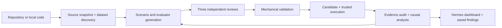

# Hermes Reliability Lab

A native **Hermes plugin** that turns an agent repository or local code directory into an evidence-based reliability campaign. It includes the orchestrator, the evaluator machinery needed by generated tests, a Hermes web dashboard tab, and a Desktop page. **The original 109 authored experiments, saved runs, and example campaign exports are not included.**

This branch is developed privately in Cornell GitHub Enterprise. The original lab and its benchmark remain on their existing branches.

## What it does

1. **Inspect the system.** Freeze a private source snapshot, read its architecture and tool interfaces, and retain source hashes and citations.
2. **Find realistic workloads.** Select relevant datasets before scenario generation. For unfamiliar agents, a model-assisted source profile guides Hugging Face and Zenodo API searches.
3. **Build experiments.** Generate scenario JSON, controlled comparisons, assertions, and campaign-local evaluator changes. Validate schema, paths, assertion coverage, and source references.
4. **Challenge the design.** Separate task-quality, experimental-validity, and verification/attribution reviewers inspect the proposal. Their conversations and judgments are saved independently.
5. **Execute when configured.** Preflight prerequisite references and run candidate and frozen trusted evaluators against the target. Retain tool traces, service/file state, API evidence, audit results, and revision hashes.
6. **Explain and iterate.** Analyze cited execution evidence, distinguish agent failures from evaluator defects and missing evidence, and refine within explicit request, generation, test-count, and round budgets.

This is executable orchestration, validation, runtime integration, and evidence storage—not a collection of prompts. Model judgments are still judgments: a passing check or reviewer approval is not a general reliability guarantee. Reaching a generation cap does not mean all reviewers approved; those results remain visible.



## Install in Hermes

Use a current Hermes release with native plugins, `ctx.llm`, CLI subcommands, and dashboard extensions. The manifest requires Hermes **0.21.5+**; validation for this build uses upstream commit `acdc8f1ba65c0231ae8277e846a4d55928913991`. Target-runtime compatibility is a separate concern described below.

Clone the **plugin branch** into your active profile's plugin directory. Authenticate Git to Cornell in your usual way first:

```bash
git clone --branch codex/hermes-reliability-plugin --single-branch \
  https://github.coecis.cornell.edu/sj945/agent-regression.git \
  "${HERMES_HOME:-$HOME/.hermes}/plugins/hermes-reliability"

hermes plugins enable hermes-reliability
hermes plugins doctor "${HERMES_HOME:-$HOME/.hermes}/plugins/hermes-reliability" --ci
```

Accept Hermes's dependency installation if prompted. Restart your running Hermes session/gateway after enabling. For named profiles, use that profile's `HERMES_HOME` and enable the plugin in that profile. No plugin-specific orchestration API key is required: **orchestration uses the active profile's Hermes model and host-owned authentication through `ctx.llm`**. Session-only model overrides are not transferred into the independent CLI worker.

Open `hermes dashboard` and select **Reliability Lab**. Hermes Desktop also has a **Reliability Lab** extension/page; enable its Desktop half in Plugins. Both use the same profile-local campaign store.

Start with scenario design:

```text
Use Reliability Lab to design reliability tests for /absolute/path/to/my-agent.
Focus on recovery after interrupted tool calls and repeated external actions.
```

Or use the CLI:

```bash
hermes reliability start /absolute/path/to/my-agent --runtime custom \
  --scope "Recovery from interrupted tool calls and duplicate actions"
hermes reliability status
hermes reliability stop JOB_ID
hermes reliability evidence CAMPAIGN_ID campaign.json
```

The native tools are `reliability_start`, `reliability_status`, `reliability_stop`, and `reliability_evidence`. `/reliability status` lists campaigns. Launch returns a job ID; a separate Hermes CLI worker performs the campaign, and closing the browser does not stop it. Stops are cooperative at safe boundaries; an in-flight source request, provider call, or target execution finishes or reaches its configured timeout first. If a worker exits unexpectedly, its job is shown as interrupted and its evidence is retained. You can reuse its generated tests in a new campaign; the plugin does not silently replay interrupted external actions.

## Dataset grounding

| Target | Starting sources |
|---|---|
| Hermes | [AssistantBench](https://huggingface.co/datasets/AssistantBench/AssistantBench), [WebLINX](https://huggingface.co/datasets/McGill-NLP/WebLINX) |
| OpenHands | [SWE-chat](https://huggingface.co/datasets/SALT-NLP/SWE-chat), [Pi development sessions](https://huggingface.co/datasets/badlogicgames/pi-mono) |
| DeerFlow | [Clem's ML Intern sessions](https://huggingface.co/datasets/clem/ml-intern-sessions), [Lewis Tunstall's sessions](https://huggingface.co/datasets/lewtun/ml-intern-sessions), WebLINX, AssistantBench |
| Any other agent | Architecture-guided searches of the Hugging Face dataset catalogue/agent-traces collection and Zenodo records, followed by relevance selection |

No paid search service is required. Discovery obtains bounded dataset cards and user-message excerpts where available, preserving URLs, hashes, selection rationale, and sampling errors. It excludes answer keys, tool results, and recorded thinking from workload seeds. These are inspiration for controlled scenarios; the plugin does not replay entire public sessions or claim they all have equivalent provenance. Some sources are unavailable or gated, and a metadata-only source is labeled accordingly. An empty custom search fails visibly rather than silently substituting AssistantBench.

`HF_TOKEN` is optional for gated/private Hugging Face access. Configure it through Hermes's secret management, not a file in this repository. Public discovery works without it. `dataset_discovery` in plugin settings can select explicit sources or disable discovery for a controlled offline development run; disabled discovery is recorded in campaign evidence.

## Executing targets

**Any repository can be inspected and used for scenario design. Executing an arbitrary agent requires a compatible integration.** Built-in runtime adapters remain available for Hermes, OpenHands, and DeerFlow; other systems use a trusted adapter factory. The plugin does not infer an unknown runtime's deployment, tools, checkpoint semantics, or credentials merely from a URL.

Execution is off by default. Configure the target and runtimes under `plugins.entries.hermes-reliability.settings` in the active Hermes profile. Example:

```yaml
plugins:
  enabled: [hermes-reliability]  # retain your other enabled plugins
  entries:
    hermes-reliability:
      settings:
        execution_enabled: true
        requests: 100
        timeout_seconds: 180
        target:
          base_url: http://localhost:1234/v1
          model: your-exact-target-model-id
        runtimes:
          hermes:
            python: /absolute/path/to/target-hermes/.venv/bin/python
            max_iterations: 15
            timeout_seconds: 1800
          custom:
            factory: /absolute/path/to/integration.py:create_adapter
```

For a hosted target, configure `RELIABILITY_TARGET_API_KEY` through Hermes. The orchestration model's credentials are never extracted or copied. The target adapter receives only the separately configured target credential. An unauthenticated local model server may leave it unset. Target inference currently requires an OpenAI-compatible Chat Completions endpoint; orchestration follows the provider support of Hermes itself.

Then explicitly request execution through the dashboard checkbox, the `execute` tool parameter, or:

```bash
hermes reliability start https://github.com/NousResearch/hermes-agent.git \
  --runtime hermes --revision TARGET_COMMIT --execute
```

Model-initiated execution passes through Hermes's approval hook. The CLI flag and dashboard checkbox are direct operator requests. Target Hermes runs retain their native approval gate; this plugin does not select auto-approval. An unattended target may refuse operations that require an interactive approval, and those refusals must be interpreted as such.

**Execution boundaries matter:** the target Hermes process and generated evaluator Python run on the host. The existing OpenHands/DeerFlow adapters run target tools in pinned, nonroot Docker containers with their configured no-network/no-host-mount boundary; that does not sandbox the host evaluator. Custom integrations control their own target isolation. Use an appropriate test machine/environment for execution. Design mode never executes generated evaluator Python or target tools.

See [runtime integration](docs/runtime-integration.md) for the custom adapter contract and retained runtime limitations.

## Evidence and privacy

State lives under `<active Hermes home>/plugin-data/hermes-reliability/`, outside the plugin install directory. Each job has its configuration, a frozen and hash-checked controller snapshot, and worker log; each campaign has private source snapshots, dataset provenance, generated scenarios, review decisions, candidate/trusted evaluator snapshots, execution reports, and causal analysis. Evidence reads are bounded and confined to the selected campaign. The web dashboard uses Hermes authentication and the documented dashboard SDK; it exposes no separate unauthenticated listener.

Source excerpts, sampled dataset user messages, and campaign evidence are sent to the configured model provider during orchestration. Public catalogues receive search queries; Git contacts the requested repository. Target execution may incur separate model costs. Recognized credential values are redacted, but repository and task contents can still be sensitive. Nothing uploads campaigns or findings to Cornell, GitHub, or a marketplace automatically.

## Development and verification

```bash
uv sync --group dev
uv run python -m unittest discover -s tests -q
uv run ruff check .
node --check dashboard/index.js
node --check dashboard/workbench/app.js
node --check desktop/plugin.js
hermes plugins doctor . --ci
hermes plugins validate .
```

Tests use small synthetic fixtures; they do not require the removed benchmark, paid model calls, or public trace downloads. Docker-dependent target tests skip without their images. The plugin integration tests exercise host-client request budgets and evidence, source preparation, scenario generation, three reviewer passes, job cancellation, approval gating, and isolated registration. Browser verification exercises the web workbench with a local authenticated SDK test host. See [verification notes](docs/verification.md) for this build's results and limits.

This private Cornell branch is **not a public catalog submission**. Hermes catalog admission requires a publicly cloneable source repository, and the retained target harness's private-runtime imports need explicit compatibility review before claiming broad release support. No public repository, marketplace entry, hackathon form, or social post is changed by installing or running this plugin.
